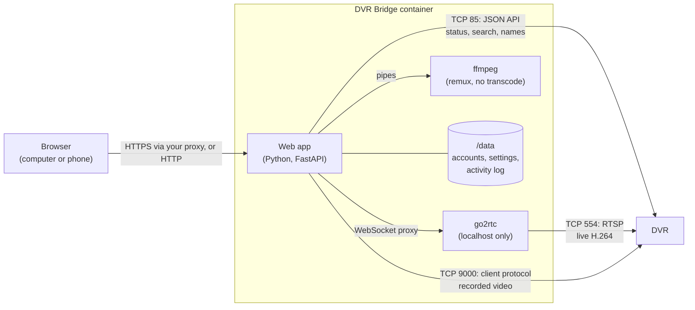

# DVR Bridge

**A modern web interface for older RaySharp-based CCTV DVRs** - the recorders sold under brands such
as Swann - whose own web page only works with a browser plugin that no current browser can run.

DVR Bridge is a small Docker container that sits next to your DVR on your network. Open it in any
current browser, on a computer or a phone, and you get your cameras back: live video, recordings you
can browse, play and download, and camera names you can edit. Your DVR keeps doing the recording;
DVR Bridge stores no footage of its own.

Not affiliated with or endorsed by Swann, RaySharp or any DVR manufacturer. Brand names are used only
to describe compatibility.

---

## Contents

- [What it does](#what-it-does)
- [Compatibility](#compatibility)
- [Installation](#installation)
- [Logins and users](#logins-and-users)
- [Configuration reference](#configuration-reference)
- [How it works](#how-it-works)
- [Monitoring](#monitoring)
- [Troubleshooting](#troubleshooting)
- [Development](#development)
- [Security](#security)
- [License](#license)

---

## What it does

**Live view**
- A grid of every camera, which opens straight away in the browser.
- Click a camera for its full-resolution stream.
- No transcoding: the DVR's own H.264 video is passed straight through, so it is light on the server
  and on the DVR.

**Recordings**
- Pick a day and see every camera's recordings on one shared timeline.
- Zoom from the whole day down to seconds with the mouse wheel, pinch, drag or the preset buttons.
- Click a clip to play it in the page, or **download it as an MP4 file**.

**Camera names**
- Rename cameras from the Settings page (admins only).
- Names are saved on the DVR itself, so the DVR's on-screen text and its own monitor output change too.

**Logins**
- Built-in accounts with optional or required authenticator-app codes (two-factor).
- Or single sign-on with any OpenID Connect provider: Authentik, Keycloak, Google, Microsoft Entra and
  others.
- Or the identity headers of an authenticating reverse proxy.
- Two roles: **admins** manage users and camera names; **viewers** watch, play and download.
- An activity log of logins, failed logins, playback, downloads and changes.

**Detections (optional, with Frigate)**
- If you run [Frigate](https://frigate.video) on the cameras, its person / car / dog / cat detections
  appear as markers on the recordings timeline, with filters per label.
- Click a marker to play the DVR's recording of that moment. When the DVR recorded nothing (its own
  motion detection did not trigger), the marker is hollow and shows Frigate's snapshot instead.

**Monitoring**
- `/healthz` for container health checks.
- Prometheus metrics: DVR reachable, disk status, which cameras are recording or have lost video,
  playback counters.

**What it does not do**
- It does not record or keep footage. Clips stream from the DVR through the container to your browser
  and are never written to disk.
- It does not change DVR settings, with one exception: renaming a camera. Firmware upgrades, resets,
  formatting, reboots and every other setting are blocked inside DVR Bridge.

## Compatibility

| Model | Firmware | Live | Recordings | Playback / download | Rename |
| --- | --- | --- | --- | --- | --- |
| Swann DVR8-4580V (hardware DM-307) | V8.1.0-20220301 | yes | yes | yes | yes |

Other RaySharp-family DVRs are likely to work if their web page lives on port 85 (or another port you
configure) and they accept the vendor's desktop/mobile client on port 9000. Many recorders sold under
the Swann, Lorex, Q-See, Night Owl and other brands are built on this platform.

**Tried it on another model?** Please open an issue with the model, the firmware version (DVR menu:
System, Information) and what worked. That is how this table grows.

## Installation

### What you need

- A machine on the same network as the DVR that runs **Docker** with Docker Compose: a home server,
  a NAS that runs containers, a Raspberry Pi 4/5 or a PC. One CPU core and 512 MB of memory are plenty.
- The DVR's **IP address** and a DVR **username and password**.
- Network access from that machine to the DVR on TCP **85** (web API), **554** (RTSP, live view) and
  **9000** (client protocol, recorded playback).

### 1. Get the code

```sh
git clone https://github.com/forcky/dvr-bridge.git
cd dvr-bridge
```

### 2. Configure

```sh
cp compose.example.yaml compose.yaml
printf '%s\n' 'your-dvr-password' > dvr_password.txt
chmod 600 dvr_password.txt
```

You can either put the DVR details in `compose.yaml` now, or leave them out and enter them in the
browser in step 4 - DVR Bridge then starts with a **setup wizard** that tests the connection for you
(remove the `DVRBRIDGE_DVR_*` lines and the `secrets` entries from `compose.yaml` if you go that way).
To configure it in the file, edit `compose.yaml` and set at least:

```yaml
DVRBRIDGE_DVR_HOST: 192.168.1.50        # your DVR's IP address
DVRBRIDGE_DVR_USERNAME: admin           # the DVR account to use
DVRBRIDGE_DVR_TIMEZONE: Europe/London   # the time zone the DVR's clock is set to
```

The time zone must match the DVR's clock (the DVR stores recording times without a zone). Use the
name from the [tz database](https://en.wikipedia.org/wiki/List_of_tz_database_time_zones), for example
`America/New_York` or `Australia/Sydney`.

### 3. Start it

```sh
docker compose up -d --build
docker compose logs dvr-bridge
```

The log shows a line like this on the first start:

```
First start: no accounts yet. Create the admin account at http://<this host>:8099/setup with setup code 7F3A-91C2-0B5E-D4A8
```

### 4. Create the admin account

Open `http://<server>:8099/` in a browser. You are sent to the login page, which links to **setup**.
Enter the setup code from the log, choose an admin username and a password of at least 10 characters,
and you are in. The code proves you run the server, so nobody else who finds the page first can claim it.

If no DVR is configured yet, you land on **Connect to your DVR**: enter its address and a DVR account,
press **Test connection** - each port and both logins are checked and the DVR's model, firmware and
camera count are shown - then **Save and connect**.

Then:
- **Account** (your name, top right): turn on two-factor authentication with an authenticator app.
- **Users**: add accounts for the rest of the household as viewers or admins.
- **Settings**: give the cameras proper names.

The example compose file publishes the port on `127.0.0.1` only. To reach it from other devices,
either change that to `8099:8099` for use inside your home network, or (better, and required for use
from outside) put a reverse proxy with HTTPS in front of it, as below.

### Network: keep the DVR locked down

These DVRs run old firmware with vendor cloud ("P2P") services that cannot always be switched off.
The setup we recommend:

1. Put the DVR on its own VLAN or network segment with **no internet access** (allow NTP if you want
   its clock kept right).
2. Allow only the DVR Bridge machine to reach the DVR, on TCP 85, 554 and 9000.
3. **Never port-forward the DVR** to the internet. Expose DVR Bridge (behind HTTPS) instead, if you need
   remote access at all.

### Behind a reverse proxy (HTTPS)

Set `DVRBRIDGE_SERVER_PUBLIC_URL` to the address people use (e.g. `https://cameras.example.com`) and
`DVRBRIDGE_AUTH_TRUSTED_PROXIES` to the proxy's address, so login throttling and the activity log see
real client addresses. The proxy must pass WebSockets (live view uses them).

**Caddy**

```
cameras.example.com {
    reverse_proxy 127.0.0.1:8099
}
```

**nginx**

```nginx
location / {
    proxy_pass http://127.0.0.1:8099;
    proxy_http_version 1.1;
    proxy_set_header Upgrade $http_upgrade;
    proxy_set_header Connection "upgrade";
    proxy_set_header Host $host;
    proxy_set_header X-Forwarded-For $proxy_add_x_forwarded_for;
    proxy_buffering off;              # recorded clips are streamed
}
```

### With Authentik (or another forward-auth proxy)

If your proxy already logs people in, let DVR Bridge trust its identity headers instead of running its
own login (`auth.mode: header`). With an Authentik proxy provider:

```yaml
DVRBRIDGE_AUTH_MODE: header
DVRBRIDGE_AUTH_HEADER_USER: X-authentik-username
DVRBRIDGE_AUTH_HEADER_GROUPS: X-authentik-groups
DVRBRIDGE_AUTH_HEADER_ADMIN_GROUP: cctv-admins
DVRBRIDGE_AUTH_HEADER_SECRET_FILE: /run/secrets/proxy_secret   # 32+ random characters
DVRBRIDGE_AUTH_TRUSTED_PROXIES: 172.18.0.0/16                   # your proxy/outpost network
```

The shared secret stops anything other than your proxy from sending those headers. In Authentik, add a
scope mapping to the provider that sends it:

```python
attrs = dict(request.user.group_attributes(request))
headers = dict(attrs.get("additionalHeaders") or {})
headers["X-DVR-Bridge-Proxy-Secret"] = "<the same secret>"
attrs["additionalHeaders"] = headers
return {"ak_proxy": {"user_attributes": attrs, "is_superuser": request.user.is_superuser}}
```

### Updating

```sh
git pull
docker compose up -d --build
```

Accounts, settings and the activity log live in the `/data` volume and are kept. Back that volume up
if you want to keep them across a rebuild of the machine.

## Logins and users

`auth.mode` chooses how people sign in:

| Mode | Who signs in | Notes |
| --- | --- | --- |
| `local` (default) | accounts kept by DVR Bridge | `auth.totp: required` makes authenticator codes mandatory |
| `oidc` | your identity provider | needs `oidc_issuer`, `oidc_client_id`, `oidc_client_secret` and `server.public_url`; the redirect URI to register is `<public_url>/auth/oidc/callback` |
| `header` | your reverse proxy | needs `header_secret` and/or `trusted_proxies`, so the headers cannot be forged |
| `none` | everyone who can reach it, as admin | only behind a proxy that already authenticates; logs a warning at every start |

- In `oidc` and `header` mode, members of the admin group (`oidc_admin_group` / `header_admin_group`)
  are admins and everyone else is a viewer, re-checked at every login. Without an admin group, new
  users start as viewers and an admin can promote them on the Users page. `oidc_allowed_group` can
  limit who may log in at all.
- `auth.local_login: true` keeps password logins available alongside SSO or headers, so a local admin
  can still get in if the identity provider is down.
- A single sign-on or proxy login can never take over a local account with the same username.
- Failed logins are slowed down per address and per account. Locked-out admins can wait 15 minutes or
  restart the container.
- **Lost the only admin password?** Stop the container, delete `dvrbridge.db` (and `dvrbridge.db-wal` /
  `dvrbridge.db-shm` if present) from the data volume - this removes all accounts and the activity log -
  start it again and use the new setup code from the log.

## Configuration reference

Admins can change all of these in the browser under **Settings, System**: changes are checked with the
same rules as at start-up, saved to `/data/config.yaml` and applied within a few seconds without a
restart (live video reconnects). Settings given as environment variables are shown there as locked, and
secrets (passwords, tokens) are never sent back to the browser - leave them blank to keep them. The page
rewrites `config.yaml`, so comments in it are not kept. For safety, the page will not switch logins off
(`auth.mode: none`), nor turn password logins off before you have signed in through the new method.

Settings come from, in order of precedence: environment variables, then `/data/config.yaml`, then the
defaults below. Each setting `section.key` has an environment variable `DVRBRIDGE_<SECTION>_<KEY>`, and
any of them can be read from a file by adding `_FILE` (for Docker secrets), e.g.
`DVRBRIDGE_DVR_PASSWORD_FILE`. `config.example.yaml` shows the file form. A wrong or unknown setting stops
the container at start-up with a message naming it.

**DVR**

| Setting | Default | Meaning |
| --- | --- | --- |
| `dvr.host` | - | DVR address (without it, DVR Bridge starts in setup-wizard mode) |
| `dvr.username` | `admin` | DVR account DVR Bridge logs in with |
| `dvr.password` | - | its password |
| `dvr.http_port` | `85` | DVR web/API port |
| `dvr.media_port` | `9000` | DVR client port (recorded playback) |
| `dvr.rtsp_port` | `554` | DVR RTSP port (live view) |
| `dvr.channels` | `0` | number of cameras; `0` asks the DVR |
| `dvr.timezone` | `$TZ`, else `UTC` | time zone the DVR's clock is set to |

**Playback, monitoring, server**

| Setting | Default | Meaning |
| --- | --- | --- |
| `playback.max_concurrent` | `2` | clips streamed at once; more get "busy, try again" |
| `playback.max_range_hours` | `3` | longest clip that can be played or downloaded |
| `monitoring.poll_interval` | `60` | seconds between DVR status checks |
| `monitoring.metrics_enabled` | `true` | serve `/metrics` |
| `monitoring.metrics_token` | empty | if set, `/metrics` needs `Authorization: Bearer <token>` |
| `server.public_url` | empty | external URL, e.g. `https://cameras.example.com` |
| `server.secret_key` | generated | signs login state; generated into `/data/secret.key` if not set |

**Detections**

| Setting | Default | Meaning |
| --- | --- | --- |
| `detection.frigate_url` | empty (off) | Frigate's internal API, e.g. `http://frigate:5000` |
| `detection.cameras` | empty | channel to Frigate camera, e.g. `1=driveway,2=front_door`; empty matches by name ("Front door" = `front_door`) |

Use Frigate's internal port 5000 from a Docker network that only DVR Bridge and Frigate share: it has no
login of its own. DVR Bridge only reads events and snapshots from it, and the browser never talks to
Frigate - snapshots are served through DVR Bridge's own login.

**Logins**

| Setting | Default | Meaning |
| --- | --- | --- |
| `auth.mode` | `local` | `local`, `oidc`, `header` or `none` |
| `auth.session_hours` | `12` | how long a login lasts |
| `auth.local_login` | `true` | password logins (in `oidc`/`header` mode: the break-glass login) |
| `auth.totp` | `optional` | `required` makes authenticator codes mandatory for local accounts |
| `auth.oidc_issuer` | | issuer URL (https) |
| `auth.oidc_client_id`, `auth.oidc_client_secret` | | client credentials from your provider |
| `auth.oidc_scopes` | `openid profile email groups` | scopes requested |
| `auth.oidc_username_claim` | `preferred_username` | claim used as the username |
| `auth.oidc_groups_claim` | `groups` | claim listing the user's groups |
| `auth.oidc_admin_group` | empty | members are admins |
| `auth.oidc_allowed_group` | empty | if set, only members (and admins) may log in |
| `auth.oidc_button_label` | `Sign in with SSO` | text of the login button |
| `auth.header_user` | `Remote-User` | header carrying the username |
| `auth.header_groups` | `Remote-Groups` | header carrying groups (`,` or `\|` separated) |
| `auth.header_admin_group` | empty | members are admins |
| `auth.header_secret` | empty | shared secret the proxy must send (32+ characters) |
| `auth.header_secret_name` | `X-DVR-Bridge-Proxy-Secret` | header carrying that secret |
| `auth.trusted_proxies` | empty | comma-separated addresses/networks of your proxies |

Also: `DVRBRIDGE_DATA_DIR` (default `/data`) and `DVRBRIDGE_CONFIG` (default `/data/config.yaml`).

**Which DVR account?** Use a separate DVR account for DVR Bridge if your DVR has spare user slots. These
DVRs often allow one web session per account, so sharing an account with someone using the DVR's own
web page can log one of you out. Renaming cameras needs an account allowed to change settings; a
view-only DVR account works for everything else.

## How it works



**Talking to the DVR (TCP 85).** The DVR has a JSON API behind HTTP Digest login, the same one its
own web page uses. DVR Bridge logs in once, keeps the session alive with a heartbeat, and uses it to:
- read device, disk and camera status (a background poll once a minute, cached, so page loads and
  metric scrapes add no DVR traffic);
- search a day's recordings;
- read and write camera names.

Only a fixed list of API calls is allowed, all read-only except the camera-name write. Logins are
rate-limited and suspended after a refusal, so a wrong password cannot get the DVR account locked.

**Live view (TCP 554).** A bundled [go2rtc](https://github.com/AlexxIT/go2rtc) pulls each camera's
RTSP stream only while someone is watching it. It listens on localhost inside the container only; the
web app passes its video to the browser over a WebSocket, and the page plays it with Media Source
Extensions. The grid uses the cameras' small sub-streams; a single camera uses the main stream. The
video is never re-encoded.

**Recordings and downloads (TCP 9000).** The DVR's API can search recordings but has no way to
download them; recorded video only comes out through the client protocol on port 9000 that the
vendor's desktop and mobile apps use. DVR Bridge implements the parts it needs from that protocol:
login, keep-alive, playback by camera and time range, and reassembling the video frames. Message
headers and payloads are scrambled with a fixed bit permutation, documented in
[`docs/protocol-codec.md`](docs/protocol-codec.md). The frames are plain H.264, which ffmpeg rewraps
(no re-encoding) into a fragmented MP4 as it streams, so a clip starts playing straight away and a
download is an ordinary `.mp4`. Each playback uses a few MB of memory however long the clip, and
nothing touches the disk: the path is DVR socket, ffmpeg, browser.

**Logins.** Accounts, sessions and the activity log are kept in SQLite under `/data`. Passwords are
hashed with scrypt; login sessions are random tokens stored only as hashes; two-factor codes follow RFC
6238. Single sign-on uses the OpenID Connect authorization code flow with PKCE. Every request that
changes something must come from DVR Bridge's own pages (same-origin JSON), which blocks cross-site
request forgery.

**What is stored where.** In `/data`: settings (if you use the file), the generated secret key and
`dvrbridge.db`. In `/tmp` (memory): go2rtc's generated configuration, which contains the DVR
credentials, readable by the container user only. No video, images or thumbnails anywhere. The DVR's
password is never logged or sent to the browser.

**Project layout**

```
dvrbridge/server.py      entry point: rebuilds the app in place when settings change
dvrbridge/main.py        web app: routes, live-view proxy, playback endpoints, settings API
dvrbridge/config.py      settings: defaults, config file, environment, validation, saving
dvrbridge/connection_test.py  the settings page's "Test connection"
dvrbridge/auth/          logins, sessions, roles, OIDC, activity log
dvrbridge/dvr/           DVR JSON API client
dvrbridge/dvr9000/       port-9000 client protocol and the bit-permutation codec
dvrbridge/go2rtc.py      go2rtc configuration and supervision
dvrbridge/playback.py    ffmpeg remux to fragmented MP4
dvrbridge/state.py       status poller and Prometheus metrics
dvrbridge/static/        pages (plain HTML/JS/CSS, no build step)
docs/                    protocol notes
tests/                   test suite with fake DVRs
```

## Monitoring

`GET /healthz` returns `ok` when the web app is running (it says nothing about the DVR, so it is safe to
expose to a health checker).

`GET /metrics` serves Prometheus metrics from the cached poll:

| Metric | Meaning |
| --- | --- |
| `dvr_up` | 1 if the last DVR poll succeeded |
| `dvr_last_success_age_seconds` | seconds since the DVR last answered |
| `dvr_disk_info{disk,status}` | disk status as a label |
| `dvr_disk_total_bytes`, `dvr_disk_free_bytes` | disk size and free space (free is 0 while overwriting) |
| `dvr_hdd_alarm` | 1 if the DVR reports a disk alarm |
| `dvr_channel_record_switch{channel}` | recording enabled for the camera |
| `dvr_channel_recording{channel}` | camera recording right now |
| `dvr_channel_videoloss{channel}` | camera has lost video |
| `dvr_channel_online{channel}` | camera connected |
| `dvr_channel_info{channel,name}` | camera name (join it onto the others for alert text) |
| `dvrbridge_go2rtc_up` | live-view helper running |
| `dvrbridge_dvr_media_session_up` | port-9000 session logged in |
| `dvrbridge_playback_active` | clips streaming now |
| `dvrbridge_playback_started_total`, `_failed_total`, `_rejected_total`, `_bytes_total` | playback counters |

Example alert for a camera that has gone dark, named in the alert:

```promql
(dvr_channel_videoloss == 1 or dvr_channel_online == 0) * on(channel) group_left(name) dvr_channel_info
```

## Troubleshooting

| Symptom | Likely cause |
| --- | --- |
| Container stops at start with a setting named in the log | that setting is missing or invalid; the message says which and why |
| Not sure why it cannot reach the DVR | Settings, System, **Test connection**: it checks each port and both logins separately |
| "DVR API unreachable" in the header | DVR address or port wrong, or the network/firewall blocks TCP 85 |
| Log says the DVR refused the login | wrong DVR username/password; DVR Bridge waits before retrying so the account is not locked - fix the password and restart |
| Live tiles stay on "connecting" | TCP 554 blocked, or your proxy does not pass WebSockets |
| Recordings list works but clips do not play | TCP 9000 blocked between DVR Bridge and the DVR |
| Clips play at the wrong time / "today" is wrong | `dvr.timezone` does not match the DVR's clock |
| "Too many clips are playing" | `playback.max_concurrent` reached; wait or raise it (the DVR also has its own limit) |
| You or the DVR's own web page keep getting logged out | DVR Bridge and someone else share one DVR account; give DVR Bridge its own |
| `/setup` sends you to the login page | setup has already been done; log in, or see "Lost the only admin password" |

## Development

Everything runs in Docker; you do not need Python installed.

```sh
docker build --target test .          # run the test suite
docker build -t dvr-bridge:dev .      # build the image
```

The tests run against fake DVRs - an HTTP API and a port-9000 media server built from scrubbed real
responses - so no hardware is needed. To click around the UI without a DVR, `tests/sim.py` runs a
simulated DVR (recordings search, camera names, status) and a simulated Frigate; its docstring has the
two `docker run` commands. Pull requests are welcome; please include tests, and keep
dependencies to a minimum.

Contributions must be your own work. Do not submit code copied, decompiled or translated from vendor
software; protocol details should come from observing behaviour, as described in `docs/`.

## Security

Please report vulnerabilities privately, as described in [`SECURITY.md`](SECURITY.md), not in public
issues.

## License

[GNU Affero General Public License v3.0](LICENSE). If you run a modified version for other people over a
network, you must offer them its source code. Third-party components and their licenses are listed in
[`NOTICE`](NOTICE).
